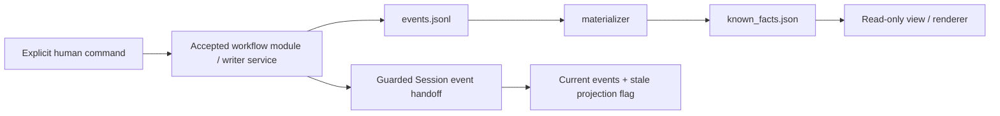
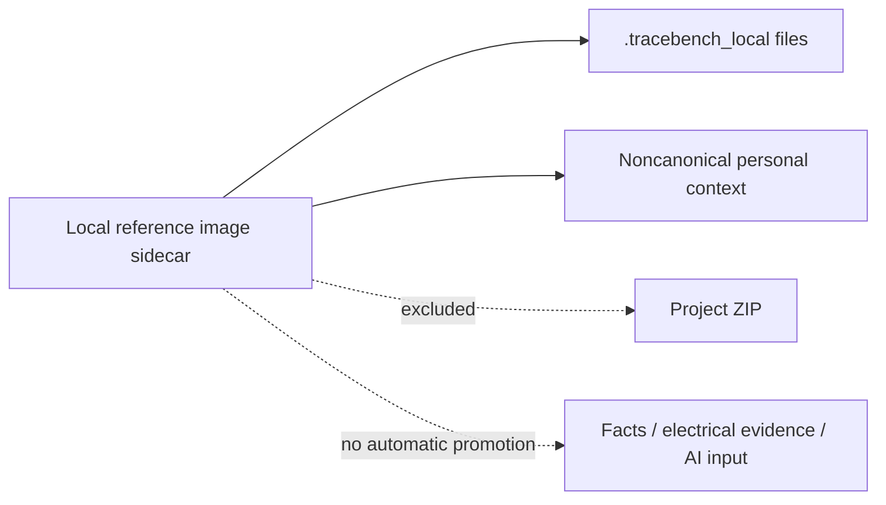

# Architecture boundaries

This is an ownership summary of accepted source, not authorization to change
data contracts. Product priorities live in CURRENT_STATE.

## Truth, commands and rendering

- Existing Components, Placement, Measurement and photo UI modules invoke their
  accepted writers after explicit human actions. They are implemented.
- Read-only renderers/painters do not write facts or events. UI-local drafts,
  selection and previews are not canonical confirmation.
- Session event application does not regenerate knownFacts. The existing
  exporter materializes, then report export reloads guarded state. A separate
  Workbench refresh is a product gap, not a new contract introduced here.
- ProjectSession owns generation/dedup/current-state replacement; writers own
  canonical persistence and materializer owns the derived projection.

## Reference and evidence boundary

Wizard backgrounds, canonical photo events and local reference images have
different owners and evidence meaning; UI_WORKFLOWS records their distinction.
Visual traces, photo alignment and package/template metadata do not prove
identity, pins, measured nets, fault or repair conclusions.
Current local reference sidecars do not feed the materializer, Board Canvas
evidence rendering or AI/OCR/CV. Changing that boundary needs explicit
protected scope.

## Canonical pointers

- Product charter: POHIKIRI; semantic invariants: TRUTH_INDEX/PROTECTED_SURFACES.
- Runtime/state/priority: CURRENT_STATE; task boundary: ACTIVE_SCOPE_LOCK.
- Event/fact contracts: exact schema/spec/runtime owners, not a diagram.
- Historical decisions and review evidence: AUDIT_INDEX/audit/archive on demand.
- board_graph.json and view_state.json remain forbidden unless separately scoped.
