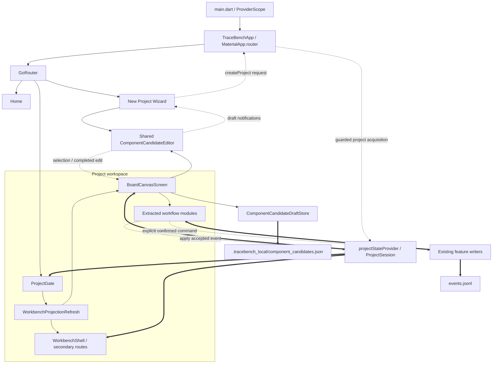
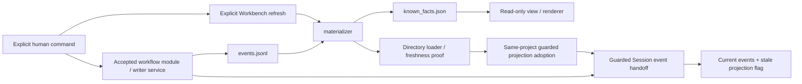
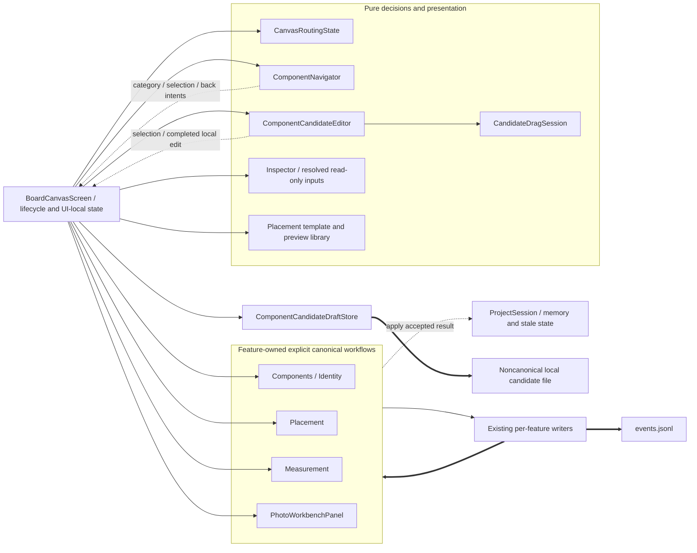
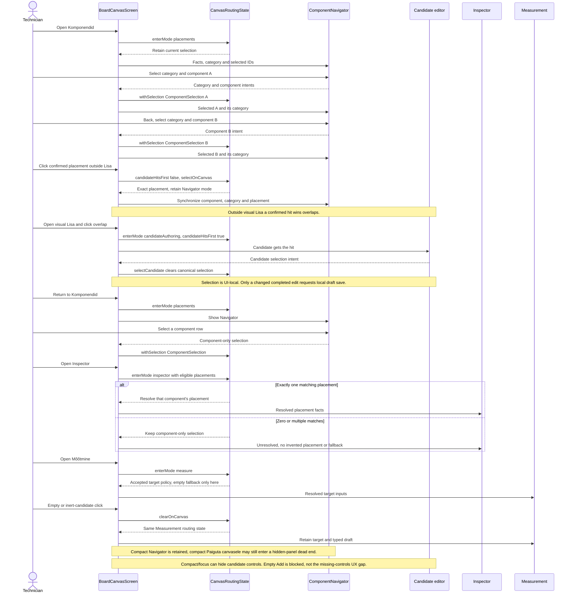
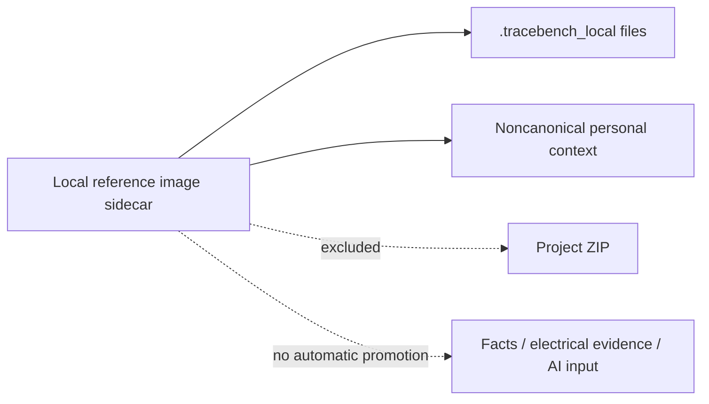

# Architecture boundaries

This is the current implementation ownership summary, verified against committed
source at `33cf477b6661d077b16b814965b1ac02bf953cb0`. It is not authorization to
change data contracts. [CURRENT_STATE](CURRENT_STATE.md) owns product priorities;
[ARCHITECTURE](ARCHITECTURE.md) preserves Sprint 0 history.

## Application skeleton

In the two flowcharts below, `-->` means composition/direct dependency,
`-.->` means callback or explicit command intent, and `==>` means state/result
flow or persistence. These are current owners, not proposed infrastructure.

The router gates project routes, not Home or New Project Wizard. Primary Canvas
uses transparent outer Material and its own instrument bar; secondary routes
use WorkbenchShell. All twelve menu destinations and nested Add/Edit/Measure
Sheet routes remain. The Canvas rail's Komponendid is ComponentNavigator;
the global `/project/components` destination is the separate ComponentListScreen.

Acquisition is caller-owned: TraceBenchApp and project acquisition actions use
ProjectCreator/ProjectLoader, then guarded Session opening. Wizard creation
persists original intake through ProjectCreator; the shared editor itself does
not create a project or write canonical events.

## Truth, commands and rendering

- Existing Components, Placement, Measurement and photo UI modules invoke their
  accepted writers after explicit human actions. They are implemented.
- Read-only renderers/painters do not write facts or events. UI-local drafts,
  selection and previews are not canonical confirmation.
- Session event application does not regenerate knownFacts. The implemented
  `WorkbenchProjectionRefresh` action invokes `ProjectProjectionRefresher`, the
  existing Python materializer and `ProjectLoader.loadFromDirectory`, without
  ZIP export. It is explicit, desktop/local-directory work, not background refresh.
- `ProjectSession.adoptRefreshedProjection` synchronously verifies generation,
  exact expected-state identity, project/directory, fresh provenance classification
  and equivalent ordered event history, then adopts only known facts/freshness.
  It retains current events, other Session context and dedup identities, and does
  not advance generation. An in-flight same-generation writer can still apply
  its result and mark stale. Open/close/full reload keep their existing generation
  transitions, so closed/replaced projects reject old completions.
- ProjectSession owns in-memory state/guards; writers own canonical persistence
  and Python owns materialization/provenance. Refresh failure preserves the active
  Session; it does not promise rollback of already generated derived disk output.

## Implemented module ownership

| Owner | Responsibility and boundary |
| --- | --- |
| Board Canvas host | Composes widgets, stores routing/category/filter/preview and candidate lifecycle state, supplies eligible identities and actual control visibility, performs hit testing and applies pure routing results. |
| CanvasRoutingState | Pure selection reconciliation, context-mode transitions, Measurement/Inspector resolution and mode-specific candidate permissions. No callbacks, rendering, Session or persistence. |
| ComponentCandidateEditor / CandidateDragSession | Shared Wizard/Canvas controls/surface/hit geometry and transient preview; the pure drag session owns threshold, displacement/grab offset, pointer identity and changed valid completion. WizardCandidateGeometry remains shared. No Session or canonical writer. |
| ComponentCandidateDraftStore | Guarded local candidate sidecar load/save with context/revision checks; no original-intake rewrite or canonical event. Wizard creation still persists its original intake through ProjectCreator. |
| ComponentNavigator | Standalone fact/selected-ID presentation and intent callbacks; host retains transient state and Placement actions. |
| Placement template/preview library | Single starter catalogue, chooser, summary and preview/ghost painter; no workflow state or writer. |
| Components / Placement / Measurement / photo modules | Existing explicit canonical workflows and writer/Session handoff; Inspector composes read-only resolved presentation and the separate local Placement editor slot. |
| Router and WorkbenchShell | Gate -> refresh wrapper -> primary Canvas transparent Material or secondary compact shell; shared navigation and twelve destinations remain. |
| Shared vocabulary / geometry | Component types/normalization and measurement-unit values are shared by existing consumers; WizardCandidateGeometry serves both candidate contexts. Canonical Placement geometry remains a separate compatibility contract. |

### Module interactions and ownership

Writers return results to the invoking workflow; that workflow applies the
accepted event through Session guards. There is no candidate-selection-to-event
path. Editor/controller changes are UI-local. Canvas alone orchestrates local
candidate sidecar persistence; the store owns file/revision safety. Inspector
may compose a separate Placement editor slot, but does not acquire writer ownership.

### Component selection sequence

Approximately 2 px mouse movement can still lose a Canvas click to panning.
These sequence notes do not resolve that gesture issue, BB-10/13 assessment or
candidate-to-canonical confirmation. Zero/multiple Inspector matches require
explicit placement choice; they are not permission for arbitrary inference.

Candidate edits and confirmed Placement use separate geometry/lifecycle contracts.
The old intake candidates seed the editor with their identity and geometry;
local revisions do not confirm component identity or migrate canonical placements.

## Reference and evidence boundary

Wizard backgrounds, canonical photo events and local reference images have
different owners and evidence meaning; UI_WORKFLOWS records their distinction.
Visual traces, photo alignment and package/template metadata do not prove
identity, pins, measured nets, fault or repair conclusions.
Current local reference sidecars do not feed the materializer, Board Canvas
evidence rendering or AI/OCR/CV. Changing that boundary needs explicit
protected scope.

Local candidate sidecars also live under `.tracebench_local/` but serve a distinct
visual-draft editor, not reference-image storage or evidence. They are excluded
from ZIP export; original optional Wizard intake can still travel in `notes/`.

## Committed-source anchors

| Claim | Current source owner |
| --- | --- |
| Startup, router, acquisition | [main.dart](../lib/main.dart), [TraceBenchApp](../lib/app/app.dart), [router](../lib/app/router.dart); ProjectCreator/ProjectLoader remain acquisition owners. |
| Gate, global navigation and secondary shell | [ProjectGate](../lib/features/project/widgets/project_gate.dart), [WorkbenchShell](../lib/features/project/widgets/workbench_shell.dart); workbenchDestinations has twelve entries. |
| Host versus pure selection decisions | [BoardCanvasScreen](../lib/features/board_canvas/screens/board_canvas_screen.dart), [CanvasRoutingState](../lib/features/board_canvas/logic/canvas_selection_routing.dart); enterMode, candidateHitsFirst and candidateAddEnabled implement the policies above. |
| Navigator and Inspector | [ComponentNavigator](../lib/features/board_canvas/widgets/component_navigator.dart), [BoardCanvasInspectorPanel](../lib/features/board_canvas/widgets/board_canvas_inspector_panel.dart); callbacks versus resolved presentation. |
| Candidate editing and drag | [ComponentCandidateEditor](../lib/features/component_candidates/widgets/component_candidate_editor.dart), [CandidateDragSession](../lib/features/component_candidates/logic/candidate_drag_session.dart), [Wizard caller](../lib/features/project/screens/new_project_wizard_screen.dart). |
| Candidate persistence and geometry | [Draft store](../lib/features/component_candidates/services/component_candidate_draft_store.dart), [WizardCandidateGeometry](../lib/shared/geometry/wizard_candidate_geometry.dart); canonical Placement geometry is separate. |
| Canonical workflow handoff | [Identity](../lib/features/board_canvas/widgets/component_identity_panel.dart), [Placement](../lib/features/board_canvas/widgets/board_canvas_placement_panel.dart), [Measurement](../lib/features/board_canvas/widgets/integrated_measure_panel.dart), [Photos](../lib/features/photos/widgets/photo_workbench_panel.dart). |
| Session and refresh | [ProjectSession](../lib/shared/session/project_session.dart), [refresh control](../lib/shared/widgets/workbench_projection_refresh.dart), [refresher](../lib/shared/services/project_projection_refresher.dart). |

No diagram overrides source/tests, POHIKIRI, TRUTH_INDEX or protected contracts.

## Canonical pointers

- Product charter: POHIKIRI; semantic invariants: TRUTH_INDEX/PROTECTED_SURFACES.
- Runtime/state/priority: CURRENT_STATE; task boundary: ACTIVE_SCOPE_LOCK.
- Event/fact contracts: exact schema/spec/runtime owners, not a diagram.
- Historical decisions and review evidence: AUDIT_INDEX/audit/archive on demand.
- board_graph.json and view_state.json remain forbidden unless separately scoped.
