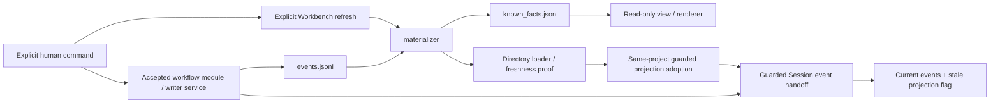
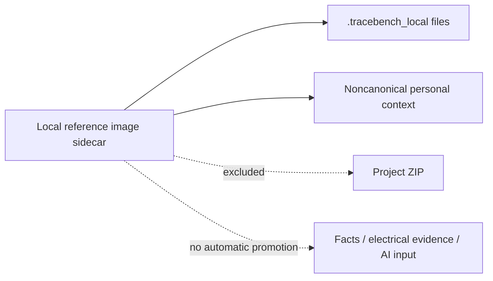

# Architecture boundaries

This is an ownership summary of accepted source, not authorization to change
data contracts. Product priorities live in CURRENT_STATE.

## Truth, commands and rendering

- Existing Components, Placement, Measurement and photo UI modules invoke their
  accepted writers after explicit human actions. They are implemented.
- Read-only renderers/painters do not write facts or events. UI-local drafts,
  selection and previews are not canonical confirmation.
- Session event application does not regenerate knownFacts. The implemented
  `WorkbenchProjectionRefresh` action invokes `ProjectProjectionRefresher`, the
  existing Python materializer and `ProjectLoader.loadFromDirectory`, without
  ZIP export. It is explicit, desktop/local-directory work, not background refresh.
- `ProjectSession.adoptRefreshedProjection` synchronously verifies generation,
  exact expected-state identity, project/directory, fresh provenance classification
  and equivalent ordered event history, then adopts only known facts/freshness.
  It retains current events, other Session context and dedup identities, and does
  not advance generation. An in-flight same-generation writer can still apply
  its result and mark stale. Open/close/full reload keep their existing generation
  transitions, so closed/replaced projects reject old completions.
- ProjectSession owns in-memory state/guards; writers own canonical persistence
  and Python owns materialization/provenance. Refresh failure preserves the active
  Session; it does not promise rollback of already generated derived disk output.

## Implemented module ownership

| Owner | Responsibility and boundary |
| --- | --- |
| Board Canvas host | Selection/filter/preview, project and candidate load/save lifecycle, Canvas hit testing/gesture routing and panel composition. |
| ComponentCandidateEditor | Shared Wizard/Canvas candidate controls, surface, hit testing and read-only painting of UI-local candidate values, using WizardCandidateGeometry. No Session or canonical writer. |
| ComponentCandidateDraftStore | Guarded local candidate sidecar load/save with context/revision checks; no original-intake rewrite or canonical event. Wizard creation still persists its original intake through ProjectCreator. |
| ComponentNavigator | Standalone fact/selected-ID presentation and intent callbacks; host retains transient state and Placement actions. |
| Placement template/preview library | Single starter catalogue, chooser, summary and preview/ghost painter; no workflow state or writer. |
| Components / Placement / Measurement / photo modules | Existing explicit canonical workflows and writer/Session handoff; Inspector composes read-only resolved presentation and the separate local Placement editor slot. |
| Router and WorkbenchShell | Gate -> shared refresh wrapper -> primary Canvas transparent Material or secondary compact shell. Twelve menu destinations and existing nested routes remain. |

Candidate edits and confirmed Placement use separate geometry/lifecycle contracts.
The old intake candidates seed the editor with their identity and geometry;
local revisions do not confirm component identity or migrate canonical placements.

## Reference and evidence boundary

Wizard backgrounds, canonical photo events and local reference images have
different owners and evidence meaning; UI_WORKFLOWS records their distinction.
Visual traces, photo alignment and package/template metadata do not prove
identity, pins, measured nets, fault or repair conclusions.
Current local reference sidecars do not feed the materializer, Board Canvas
evidence rendering or AI/OCR/CV. Changing that boundary needs explicit
protected scope.

Local candidate sidecars also live under `.tracebench_local/` but serve a distinct
visual-draft editor, not reference-image storage or evidence. They are excluded
from ZIP export; original optional Wizard intake can still travel in `notes/`.

## Canonical pointers

- Product charter: POHIKIRI; semantic invariants: TRUTH_INDEX/PROTECTED_SURFACES.
- Runtime/state/priority: CURRENT_STATE; task boundary: ACTIVE_SCOPE_LOCK.
- Event/fact contracts: exact schema/spec/runtime owners, not a diagram.
- Historical decisions and review evidence: AUDIT_INDEX/audit/archive on demand.
- board_graph.json and view_state.json remain forbidden unless separately scoped.
