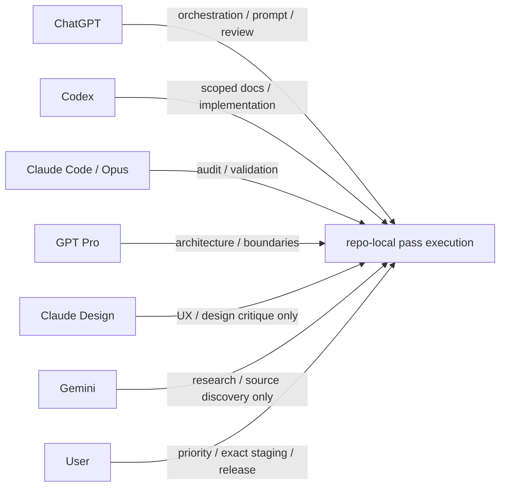

# MODEL_ROUTING.md

## Purpose

Choose the right helper/model for each pass type and risk profile.

## Model routing ownership (canonical)

`docs/MODEL_ROUTING.md` is the canonical owner for helper/model role definitions.
Prompt docs and operating docs should reference this file instead of duplicating long role blocks.

- **Codex**
  - Repo-local writer for docs/code inside the explicit compact or protected task boundary.
  - Local validation execution and deterministic patching.
  - Does not self-approve final acceptance for route-changing implementation/docs passes.
  - Implements bounded UI/docs work directly; protected contract changes follow the explicit protected scope gate.

- **Claude Code**
  - Normal independent actual-diff reviewer, mandatory where a protected/human-requested contract names Claude.
  - One independent review is sufficient for ordinary UI/docs; no automatic second audit or closeout task.

- **ChatGPT / GPT Pro**
  - Strategy, route/risk review, prompt construction, and non-final pre-audit.
  - Best for architecture, evidence-boundary policy, high-impact sequencing, and pass-order arbitration before risky implementations.
  - Does not replace the final Claude Code repo-local audit gate where that gate is required.

- **Claude Design**
  - UX/UI/spec critique, interaction design reviews, wording structure.
  - Design review only; no repo mutation and no direct ownership of code-surface acceptance decisions.

- **Gemini**
  - Research, source discovery, and external input discovery.
  - Research/input only; no repo mutation and no acceptance-gate ownership.

- **User**
  - Product-priority choice, ownership ambiguity, or any direction change not inferable from docs.
  - Manual staging, commit, and push owner.
  - Uses exact staging sets; never broad staging (`git add .` / `git add -A`).

## Routing matrix

| Situation | Route |
|---|---|
| Narrow deterministic edit with compact task boundary | Codex |
| Lane A ordinary UI/docs | Codex, then one independent diff review (normally Claude Code) |
| Lane B protected/high-risk work | Explicit protected scope, Codex, independent review; GPT Pro only for unresolved new architecture/risk |
| Independent repo-local compliance audit | Claude Code |
| Architecture/evidence-floor decision | ChatGPT / GPT Pro |
| Prompt construction or non-final pre-audit | ChatGPT / GPT Pro |
| UX/design/spec quality review | Claude Design |
| Research/source discovery | Gemini |
| Product priority or unresolved owner choice | User decision |

## Mandatory routing constraints

- Use the human's explicit compact/protected task boundary and canonical owners.
- Preserve pre-existing work and resolve an explicitly authorized docs-policy
  conflict in its owner; ask only for authorization that is genuinely missing.
- Protected data/canonical changes require explicit scope and independent review.
- A docs-only task never edits runtime, schema, tests or tools.
- Use one bounded task and one independent actual-diff review by default.
- Only the human stages/commits/pushes exact accepted files; no broad staging.
- The author cannot self-approve high-risk work; Claude Code is the normal
  independent reviewer, with GPT Pro for unresolved new protected architecture.
- V2 validator/materializer/writer owners and explicit UI writer modules exist.
  Rendering is read-only; no UI/painter bypass may mutate canonical facts.

## Lane consumption

PROMPTING_PROTOCOL owns risk classification. Ordinary Lane A work does not
require a new GPT/model-routing hop, parent lock or docs programme. Lane B
retains explicit protected scope/tests and independent review. Do not repeat
architecture review when the human decision/accepted contract already exists.

An explicitly requested complex bundle may still use a parent lock, but it
is optional; it does not create mandatory maintenance/recording/closeout
children for small UI changes.

### Accepted shorthand guard (Lane A)

- When a formal audit packet is used, compact `Accepted` can be used by user handoff only when that reviewed diff is clean:
  - `AUDIT_VERDICT` is `ACCEPT_AS_IS`;
  - `SAFE_FOR_STAGING: YES`;
  - no blockers;
  - no route/hash/scoping mismatches;
  - no unexpected changed files.
- If any condition fails, the full audit packet/evidence must be pasted.
- Route consistency for this handoff still requires `CURRENT_STATE.md`, `PASS_QUEUE.md`, and `ACTIVE_SCOPE_LOCK.md` to agree on current and next pass.

## Practical handoff pattern

1. Codex executes scoped implementation/doc pass.
2. Claude Code runs independent audit (`PASS`, `PASS_WITH_NITS`, `NEEDS_SMALL_FIXUP`, `BLOCK`).
3. If boundary/sequence uncertainty remains, escalate to GPT Pro.
4. User resolves product-priority tie-breakers and manually stages/commits/pushes using the exact staging set.

### Tool/model routing (compact)

This diagram is orientation only; canonical repo docs win.

## Minimal handoff payload requirements

Provide the task/goal, baseline, actual diff, exact boundaries, validation and
specific review questions. For ordinary work, no separate PASS_ID/Lane/Mode,
model-routing report or full formal packet is mandatory. A protected or
explicitly formal handoff retains the exact fields required by its contract.

### No self-approval rule (high-risk paths)

- Do not finalize high-risk implementations as accepted based only on Codex/Claude-internal review.
- Explicitly route through the reviewer model(s) documented in the pass plan before closure.

## MODEL_ROUTING_CHECK convention

Report a routing conflict or escalation when it materially affects the task.
Formal protected prompts may retain MODEL_ROUTING_CHECK; ordinary low-risk
work does not need the field as boilerplate.
